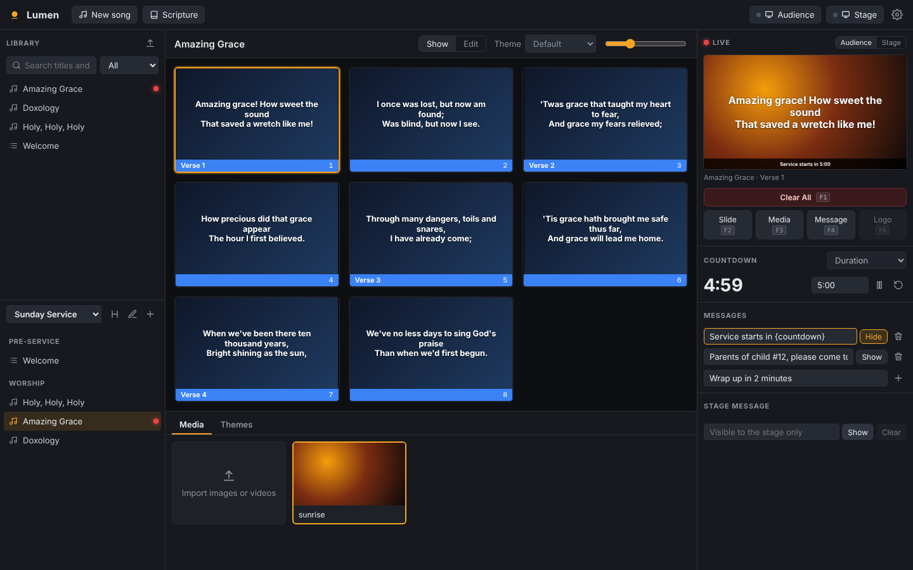
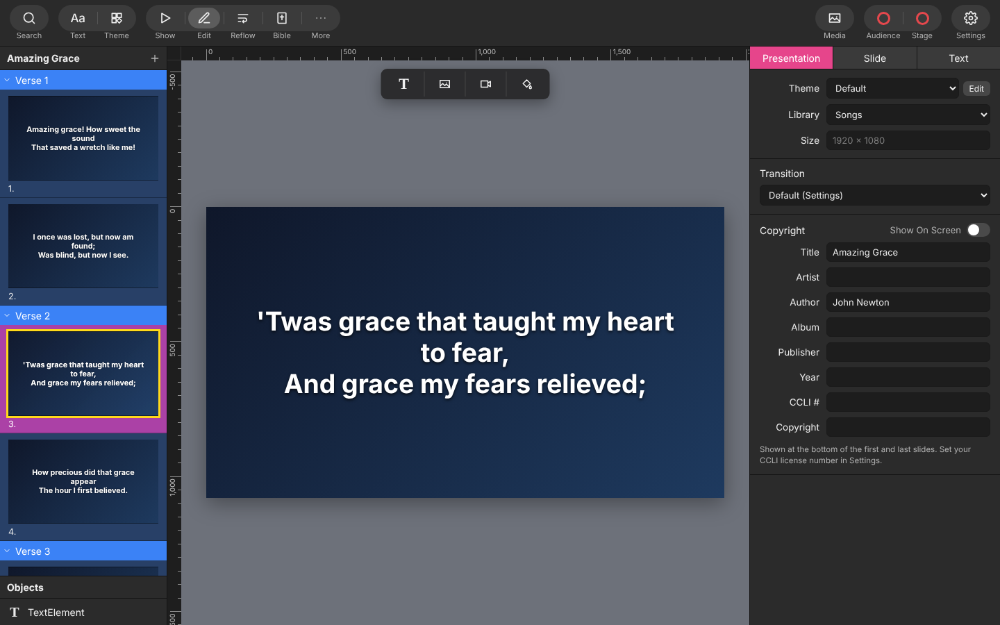

# Lumen

Live presentation software for worship services and events, in the spirit of ProPresenter. It lets you build a song and scripture library, plan the service in a playlist, and run lyrics, backgrounds, messages and countdowns on an audience screen and a stage confidence monitor.

The interface deliberately mirrors ProPresenter 7's layout and terms, so teams switching over find things where they expect them.





| Audience output | Stage display |
| --- | --- |
|  |  |

## Running it

Requires Node.js 20 or newer.

```sh
npm install
npm run dev          # operator UI at http://localhost:5173
```

Click **Audience** or **Stage** in the toolbar to open the output windows, drag them to the projector or TV, and double-click one to make it fullscreen. In Chromium-based browsers, Lumen asks for permission to place the window on your other screen automatically.

### As a desktop app (Electron)

The desktop shell opens the outputs fullscreen on your second and third displays, with no browser chrome. You can choose the screens in Settings.

```sh
npm run electron     # build, then launch the desktop app
# or, while developing:
npm run dev          # terminal 1
npm run electron:dev # terminal 2, loads the dev server with hot reload
```

### Other scripts

```sh
npm test             # unit tests (Vitest)
npm run typecheck
npm run build        # production build into dist/
npm run format       # Prettier
```

## Where things are (for ProPresenter users)

| ProPresenter | Lumen |
| --- | --- |
| Toolbar: Search · Text, Theme · Show, Edit, Reflow, Bible, More | Same buttons, same order. Text and Theme drop down panels that apply to the selected presentation. |
| Toolbar: Media, Audience, Stage | Media toggles the media bin. Audience and Stage open the output windows; the ring turns green when a screen is open. |
| Library and Playlist at the top left, items below with a Filter | Same. Libraries are Songs, Scripture, Announcements and Other. Drag a presentation onto a playlist name to add it. |
| Slide grid with numbered, colored group labels | Same. Click a slide to go live (orange border), double-click to edit it. |
| Media bin along the bottom | Same, with All Media / Images / Videos on the left. Click an item to play it behind the slides. |
| Preview with clear buttons on its right edge, ✕ for Clear All | Same: Messages, Logo, Slide and Media clear buttons light up while their layer is live. |
| Screen picker, transport, and Stage / Timers / Messages / Props tabs | Same. |
| Edit: slide list with group headers, Objects, canvas with rulers, Presentation / Slide inspector | Same. Drag or resize the text box, double-click to type on the slide. The Text tab formats one slide. |
| Reflow | Type the whole song as text with `[Verse 1]` headers. |

## Features

- **Library** of songs, scripture and announcements, with search across titles and lyrics. Drop `.txt` lyric files on it to import them.
- **Playlists** for each service, with headers and drag-and-drop ordering. Advancing past the last slide continues into the next item.
- **Slide grid** or list with group colors (Verse, Chorus, Bridge…). Click a slide to put it live.
- **Edit mode** to move and resize the text box, type directly on the slide, and give a slide its own background, formatting, caption and stage notes.
- **Reflow** where the lyrics text is the whole presentation: groups, slides, arrangement, captions and stage notes. Edit-mode changes survive reflowing.
- **Themes** with font, size, colors, shadow, outline, alignment, margins, a lower-third box, and color, gradient or media backgrounds. Text shrinks automatically to fit. Per-presentation formatting from the Text button sits on top of the theme.
- **Copyright line** (title, author, publisher, CCLI song and license numbers) on the first and last slides when "Show On Screen" is on.
- **Per-presentation transitions**: cut or fades of different lengths.
- **Media bin** for images and looping videos as backgrounds, stored locally in IndexedDB, with pause and restart.
- **Layers** as in ProPresenter: background, slide, message and logo, each cleared on its own, with crossfade transitions.
- **Countdown timer**, either a duration or a time of day, shown on the stage display and usable in messages.
- **Messages** on the audience screen, with `{countdown}` and `{clock}` tokens.
- **Stage display** showing the current and next slide, notes, clock, timer, and a flashing message to the stage.
- **ProPresenter import** of `.pro` presentations and `.rvbible` Bibles (see below).
- **Bible** lookups from imported Bibles (offline, with book and chapter pickers) or public-domain translations via [bible-api.com](https://bible-api.com), or paste any text.
- **Persistence**: everything saves automatically, and the library exports to and imports from JSON.

## Importing from ProPresenter

Use the import button in the Library header, **More → Import**, or drag files onto the Library. You can select many files at once.

| File | What comes across |
| --- | --- |
| `.pro` (ProPresenter 7 presentation) | Title, groups with their names and colors, slide text (from every text box), slide notes, the selected arrangement, CCLI details (author, publisher, year, song number, "show on screen") and the transition length. Slide layouts, fonts and media don't import; your Lumen theme applies instead. |
| `.rvbible` (ProPresenter Bible) | The whole translation, stored on this computer so lookups work offline. Pick it in the **Bible** dialog and type references in the Bible's language or in English: `Juan 3:16-18`, `Sal 23`, `1 Co 13`, `John 3:16`. Manage imported Bibles in Settings. |
| `.txt` | Lyrics in the Reflow format below. |

ProPresenter 6 files (`.pro6`) and playlists (`.proplaylist`) aren't supported yet. Bible text and media stay on the computer; library exports don't include them. Check that your licence covers projecting the translations you import.

## Writing lyrics

```text
[Verse 1]
Amazing grace! How sweet the sound
That saved a wretch like me!

I once was lost, but now am found;
Was blind, but now I see.
> Band drops out here

[Chorus]
...

[Verse 2]
...

[Chorus]
```

| Syntax | Meaning |
| --- | --- |
| `[Name]` | Starts a group. Its color comes from the name. |
| blank line | Starts a new slide |
| `[Name]` with nothing under it | Repeats an earlier group in the arrangement |
| `~ text` | Caption under the slide, such as a scripture reference |
| `> text` | Note shown only on the stage display |

## Keyboard

| Key | Action |
| --- | --- |
| `→` `↓` `Space` `PgDn` | Next slide |
| `←` `↑` `PgUp` | Previous slide |
| `C`, `V`, `B`, … | Jump to the next group starting with that letter |
| `F1` | Clear all |
| `F2` / `F3` / `F4` | Clear slide / media / message |
| `F6` | Toggle logo |

Clickers that send arrow keys or Page Up/Down work out of the box. In Edit mode, the arrow keys nudge the selected text box (Shift for 10px), Enter starts typing, and Escape deselects.

## How it works

```
src/
  types.ts         data model: presentations, themes, playlists, live state, output frame
  store.ts         Zustand store: library, playlists, slide editing, live control, timer (saved to localStorage)
  lyrics.ts        text ⇄ groups/slides/arrangement parser
  theme.ts         theme → presentation → slide formatting, backgrounds, copyright line
  bible.ts         imported Bibles: storage, reference parsing (local + English book names), lookup
  commands.ts      new presentation, file import
  import/          readers for ProPresenter .pro (protobuf + RTF) and .rvbible (zip of USX books)
  frame.ts         derives the OutputFrame from the store
  sync.ts          BroadcastChannel between the operator and output windows
  liveFrame.ts     pushes each new frame to output windows and the operator's monitor
  media.ts         IndexedDB storage for images and videos
  outputs.ts       opens output windows (browser popups or Electron windows)
  components/
    ControlApp     window layout per mode and keyboard shortcuts
    Toolbar        ProPresenter-style toolbar with Search / Text / Theme / More popovers
    Sidebar        Library and Playlist collections with their items
    ShowView       slide grid and list
    MediaBin       media sidebar and bin
    LivePanel      preview, clear buttons, transport, Stage / Timers / Messages / Props
    EditView       slide outline, canvas editor with rulers, inspector
    ReflowView     lyrics text editor
    Canvas         1920×1080 canvas, auto-fitting text, layered output, transitions
    OutputApp      audience window   (#/output)
    StageApp       stage display      (#/stage)
    ThemeEditor, Dialogs
electron/          desktop shell: display placement, app:// protocol
```

The operator window owns all state. Every change produces an `OutputFrame`, a self-contained description of what each screen should show, which goes to the output windows over `BroadcastChannel`. Output windows hold no library data. They render the frame and load media from the IndexedDB they share with the operator window. Every view renders onto the same fixed 1920×1080 canvas and scales it, so text wraps the same way in thumbnails, the monitor and the projector.

## Roadmap ideas

- Multiple arrangements per song
- More objects in Edit (extra text boxes, shapes, images), and slide builds
- Slide hotkeys and group color presets shared across songs
- Audio bin and video playback with sound and transport controls
- Remote control from a phone over WebSocket
- NDI or capture-card output for livestreams
- Import ProPresenter 6 and playlists, OpenLP, OpenSong, CCLI SongSelect and Planning Center
- CCLI usage reporting
- Installers with electron-builder
