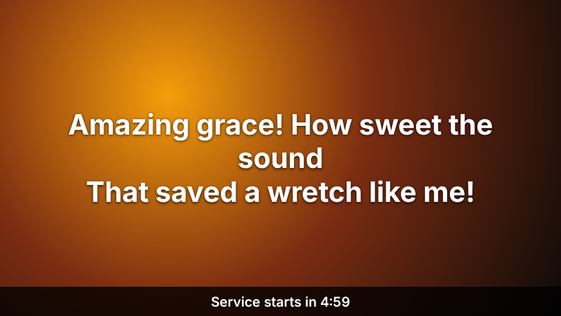

# Lumen

Live presentation software for worship services and events, in the spirit of ProPresenter. It lets you build a song and scripture library, plan the service in a playlist, and run lyrics, backgrounds, messages and countdowns on an audience screen and a stage confidence monitor.

The interface deliberately mirrors ProPresenter 7's layout and terms, so teams switching over find things where they expect them.


| Audience output                | Stage display            |
| ------------------------------ | ------------------------ |
|  |  |

## Running it

Requires Node.js 20 or newer.

```sh
npm install
npm run dev          # operator UI at http://localhost:5173
```

The first time Lumen starts, it asks you to choose its icon: the **Projector** (the default, already selected), the blue **Star**, the yellow **Camera** or the black-and-white **Film Camera**. You can change it later in **Settings → App Icon**. The choice applies to the browser tab and, in the desktop app, to the Dock or taskbar.

Click **Audience** or **Stage** in the toolbar to open the output windows. In Chrome or Edge, open **Screens → Configure Screens…** (More menu, or right-click Audience) and press **Detect Screens** once: the outputs then open fullscreen on your TV or projector by themselves. In other browsers, drag the window to the projector and double-click it for fullscreen.

### As a desktop app

The desktop app is built with [Tauri](https://tauri.app). It's a small native app that uses the web engine already in the computer (Safari's on a Mac, WebView2 on Windows) instead of bundling a browser. It opens each output fullscreen on its display, adds ProPresenter's **Screens** menu (⌘1 Audience, ⌘2 Stage, ⌥⌘1 Configure Screens…, Identify Screens), and lists displays by their real names. Outputs come up as soon as an HDMI cable goes in and return when an unplugged screen is reconnected.

One-time setup:

- **Mac:** install Apple's command-line tools with `xcode-select --install`, then Rust with `curl --proto '=https' --tlsv1.2 -sSf https://sh.rustup.rs | sh`. Close and reopen Terminal afterwards.
- **Windows:** install the Microsoft C++ Build Tools (the "Desktop development with C++" workload), then Rust from [rustup.rs](https://rustup.rs). WebView2 already comes with Windows 10 and 11.
- **Linux:** the WebKitGTK packages in [Tauri's prerequisites](https://tauri.app/start/prerequisites/), then Rust.

```sh
npm run desktop        # run the desktop app while you work on it (reloads as you edit)
npm run desktop:build  # build the finished, installable app
```

`desktop:build` puts the app in `src-tauri/target/release/bundle/`. On a Mac that's `macos/Lumen.app` (drag it into Applications) and a `.dmg` disk image; on Windows, an `.msi` installer and a setup `.exe`. The first build downloads and compiles the Rust libraries and takes several minutes; later builds are much quicker.

An app you build runs on your own computer. Before it can be handed to other Macs without the "unidentified developer" warning, it has to be signed and notarized with an Apple Developer account. Until then, right-click the app and choose **Open** the first time. A signed build also needs the camera entitlement (`com.apple.security.device.camera`) for Video Input; `src-tauri/Info.plist` already has the message macOS shows when it asks.

### Other scripts

```sh
npm test             # unit tests (Vitest)
npm run typecheck
npm run build        # production build into dist/
npm run format       # Prettier
```

## Where things are (for ProPresenter users)

| ProPresenter                                                                                                                         | Lumen                                                                                                                                                                                                                                              |
| ------------------------------------------------------------------------------------------------------------------------------------ | -------------------------------------------------------------------------------------------------------------------------------------------------------------------------------------------------------------------------------------------------- |
| Toolbar: Search · Text, Theme · Show, Edit, Reflow, Bible, More                                                                      | Same buttons, same order. Text and Theme drop down panels that apply to the selected presentation.                                                                                                                                                 |
| Toolbar: Media, Audience, Stage                                                                                                      | Media toggles the media bin. Audience and Stage turn those screens on or off; the ring is green when they're showing and orange when some outputs aren't. Right-click either one to configure screens.                                             |
| Screens menu and Screen Configuration (⌥⌘1)                                                                                          | Same layout: Audience and Stage lists with on/off switches and +, Identify Screens, Test Patterns, then per screen its name, size, Screen Color, Outputs, the output tiles, and Hardware / Color / Corner Pin / Alpha Key tabs. See Screens below. |
| Bible: reference with Book › Chapter › Verse menu, Search, Options; translation with Verse and Reference boxes, License, +; Save As… | Same layout and options. See Bible below.                                                                                                                                                                                                          |
| Dividers between the panes (library, slides, media bin, live panel, and above the live panel’s tabs)                                 | Same: drag to resize, double-click to reset. Edit mode’s slide list and inspector resize too. Sizes are kept.                                                                                                                                      |
| Library and Playlist at the top left, items below with a Filter                                                                      | Same. Libraries are Songs, Scripture, Announcements and Other. Drag a presentation onto a playlist name to add it.                                                                                                                                 |
| Slide grid with numbered, colored group labels                                                                                       | Same. Click a slide to go live (orange border), double-click to edit it.                                                                                                                                                                           |
| Media bin along the bottom                                                                                                           | Same, with All Media / Images / Videos and Video Inputs on the left. Click an item to play it behind the slides, or a camera to show it underneath.                                                                                                |
| Preview with clear buttons on its right edge, ✕ for Clear All, Clear Groups underneath                                               | Same column in the same order: Audio, Messages, Logo (where ProPresenter has Props), Announcements, Slide, Media, Video Input. Each lights up while its layer is live. Clear Groups clear several layers at once.                                  |
| Screen picker, transport, and Audio / Stage / Timers / Messages / Props tabs                                                         | Same. The Audio tab is the audio bin.                                                                                                                                                                                                              |
| Edit: slide list with group headers, Objects, canvas with rulers, Presentation / Slide inspector                                     | Same. Drag or resize the text box, double-click to type on the slide. The Text tab formats one slide.                                                                                                                                              |
| Reflow                                                                                                                               | Type the whole song as text with `[Verse 1]` headers.                                                                                                                                                                                              |
| Right-click menus                                                                                                                    | Same: slides, group headers, the Edit canvas, library and playlist items, playlists, headers and media each have one. See Slides, groups and labels below.                                                                                         |
| Copy Style / Paste Style (⌥⌘C / ⌥⌘V)                                                                                                 | Same: right-click a slide, or the Text tab's Copy Style and Paste Style buttons. Paste onto one slide, a group, or every slide.                                                                                                                    |
| Group and Label (right-click a slide), Edit Groups…                                                                                  | Same. Picking a group starts it at that slide. Labels are colored tags on the thumbnails. **Edit Groups & Labels…** sets the lists.                                                                                                                |
| Transitions                                                                                                                          | Thirteen kinds with direction, length and easing, for a slide (right-click, or its badge), a group, a presentation (the button under the slides), every slide (**Global**, the button under the preview) or media from the media bin.              |

## Features

- **Library** of songs, scripture and announcements, with search across titles and lyrics. Drop `.txt` lyric files on it to import them.
- **Playlists** for each service, with headers and drag-and-drop ordering. Advancing past the last slide continues into the next item.
- **Slide grid** or list with group colors (Verse, Chorus, Bridge…). Click a slide to put it live.
- **Edit mode** to move and resize the text box, type directly on the slide, and give a slide its own background, formatting, caption and stage notes.
- **Reflow** where the lyrics text is the whole presentation: groups, slides, arrangement, captions and stage notes. Edit-mode changes survive reflowing.
- **Themes** with font, size, colors, shadow, outline, alignment, margins, a lower-third box, and color, gradient or media backgrounds. Text shrinks automatically to fit. Per-presentation formatting from the Text button sits on top of the theme.
- **Fonts**: Copperplate from the computer (with a free bundled stand-in), any installed font by name, and font files you add (see below).
- **Copyright line** (title, author, publisher, CCLI song and license numbers) on the first and last slides when "Show On Screen" is on.
- **Transitions**: Cut, Dissolve, Fade, Push, Slide, Reveal, Wipe, Split, Iris, Zoom, Blur, Flip and Cube, with a direction, length and easing, for one slide, a group, a presentation, every slide (global), and media backgrounds. One panel sets any of them, with a preview that plays the transition.
- **Undo and redo** for every change to the library, slides, playlists, themes and messages (see Undo below).
- **Right-click menus** everywhere, **Copy / Paste Text Style**, **group presets** and **slide labels** (see Slides, groups and labels below).
- **Media bin** for images and looping videos as backgrounds, stored locally in IndexedDB, with pause and restart.
- **Layers** as in ProPresenter: Video Input, Media, Slide, Announcements, Logo, Messages and Audio, each cleared on its own or with a **Clear Group** (see Layers below).
- **Audio bin** in the live panel: music and sound effects that play from this computer, loop if you like, and fade out when cleared.
- **Announcements**: a presentation can play on its own layer over the slides, and any presentation can advance by itself (an announcement loop).
- **Video Input**: webcams, capture cards and virtual cameras (OBS, NDI) as a live layer under everything.
- **Countdown timer**, either a duration or a time of day, shown on the stage display and usable in messages.
- **Messages** on the audience screen, with `{countdown}` and `{clock}` tokens.
- **Stage display** showing the current and next slide, notes, clock, timer, and a flashing message to the stage.
- **ProPresenter import** of `.pro` presentations, `.proplaylist` playlists and `.rvbible` Bibles (see below).
- **Bible mode**, laid out like ProPresenter's (see Bible below), from imported Bibles (offline) or public-domain translations via [bible-api.com](https://bible-api.com).
- **Persistence**: everything saves automatically, and the library exports to and imports from JSON.

## Slides, groups and labels

Right-click a slide (in Show mode's grid or list, or Edit mode's slide list) for:

- **Show Slide**, **Edit Slide**, **Cut / Copy / Paste / Duplicate**, **Insert Blank Slide**, **Delete Slide…**. Copied slides paste into any presentation, Bible verses included.
- **Copy Text Style** and **Paste Text Style**: the font, size, weight, color, caps and alignment as the slide shows them (not the text box's position). **Paste Text Style To** puts it on the slide's group or every slide; on every slide it becomes the presentation's formatting. **Clear Text Style** goes back to the theme.
- **Group**: Verse 1–4, Pre-Chorus, Chorus, Bridge, Tag, Vamp, Intro, Interlude, Outro, Ending, or **New Group…**. As in ProPresenter, a group starts at the slide you pick it on, and the slides after it in its old group come along. Picking a group on a group's first slide renames and recolors that group.
- **Label**: a colored tag on the thumbnail, a cue for whoever runs slides (Welcome, Prayer, Offering, Key Change, Last Time…), or **Custom Label…**.
- **Transition**: the default, or a kind (by direction, for those that move), a **Duration**, an **Easing**, or **Transition Options…** for the transition panel. A slide with its own transition shows a small badge; click the badge to change it.

Right-click a **group header** in Edit mode to rename it, recolor it, pick a preset, add a slide, duplicate it, paste a text style on all of its slides, give them a transition, or delete it. **Edit Groups & Labels…** (from the Group and Label menus, the Slide inspector or Settings) changes the lists of groups and labels; slides already using one keep theirs.

The Slide inspector in Edit mode has the same choices: the slide's group, its label, and its transition. The Text tab has **Copy Style** and **Paste Style**.

### Transitions

| Kind     | What it does                                    | Directions            |
| -------- | ----------------------------------------------- | --------------------- |
| Cut      | Straight to the next slide                      |                       |
| Dissolve | The next slide fades in as this one fades out   |                       |
| Fade     | This slide fades out, then the next fades in    |                       |
| Push     | The next slide pushes this one off              | ← → ↑ ↓               |
| Slide    | The next slide slides in over this one          | ← → ↑ ↓               |
| Reveal   | This slide slides away, uncovering the next     | ← → ↑ ↓               |
| Wipe     | An edge sweeps across, revealing the next slide | ← → ↑ ↓               |
| Split    | The next slide opens out from the middle        | sideways, up and down |
| Iris     | The next slide opens in a growing circle        |                       |
| Zoom     | The next slide grows in as this one grows away  |                       |
| Blur     | Blurs out, and the next slide comes into focus  |                       |
| Flip     | Turns over like a card                          | ← → ↑ ↓               |
| Cube     | Turns like the sides of a cube                  | ← → ↑ ↓               |

Each has a length (0.1 to 3 seconds) and an easing: **Even**, **Ease In**, **Ease Out** or **Ease In & Out**. Each kind starts with the easing that suits it, such as Even for a wipe and Ease Out for a slide.

The **transition panel** sets them all, with a preview that plays the one you're choosing. Its tabs are the levels a transition can be set at:

- **Slide**: just this slide. Open it by right-clicking a slide, then **Transition ▸ Transition Options…**, by clicking a slide's transition badge, or from the Slide inspector. **Use for All of “Chorus”** and **Use for Every Slide** apply the slide's transition more widely.
- **Group**: every slide in the group. Right-click a group header in Edit mode.
- **Presentation**: every slide in the presentation without its own. Use the button under the slides in Show mode, the Presentation inspector, or right-click the presentation in the library. **Clear Them** removes the slides' own transitions.
- **Global**: every slide of every presentation, unless the presentation or slide has its own. Use the **Global** button under the preview, or Settings. **Use Global Everywhere** clears every presentation's and slide's own transition.
- **Media**: backgrounds from the media bin, as they start, change and clear. Right-click a media item, or use Settings.

A slide comes on screen with its own transition, else its presentation's, else the global one. A background that changes with the slide (a slide's own background, or a different theme's) moves with it, so a Push pushes both. Clearing a layer fades it out. Messages and the logo fade over the global transition's length. ProPresenter's transitions import as the nearest kind, with their direction and length.

## Undo

**⌘Z** (Ctrl+Z) undoes, **⇧⌘Z** (Ctrl+Shift+Z, or Ctrl+Y) redoes. They're also at the top of the **More** menu and, in the desktop app, in **Edit**, named after the step they'd take ("Undo Delete Slide"). A note at the bottom of the window says what was undone, and in which presentation.

- Each action is one step: deleting, cutting or pasting slides, a group or label, a pasted text style, a transition, a rename, moving a playlist item, an import.
- Typing in a field, or dragging a slider or color, is one step for as long as you keep at it.
- In a text field, ⌘Z undoes the typing, as usual; click outside it to undo whole steps.
- Showing slides, clearing the screen, Bible mode's passage, screen setup, pane sizes and other preferences aren't edits and stay as they are.
- Up to 200 steps, until Lumen is closed. A deleted media file is kept until the next launch, so undoing brings it back.

## Layers

The column on the right of the preview clears one layer each, top to bottom as in ProPresenter (there's no Props layer; Lumen's logo sits in its place). A layer's button lights up while it has something on it, and **✕** clears them all (F1).

| Layer         | What's on it                                                                                      | Clear |
| ------------- | ------------------------------------------------------------------------------------------------- | ----- |
| Audio         | A track from the **Audio** tab, playing from this computer. Clearing fades it out.                | F5    |
| Messages      | A message from the Messages tab                                                                   | F4    |
| Logo          | The logo (Props tab, or a media item's right-click menu)                                          | F6    |
| Announcements | A slide from a presentation that plays on Announcements, with its own background, over the slides |       |
| Slide         | The slide, and the background that goes with it                                                   | F2    |
| Media         | An image or video from the media bin, in place of slide backgrounds                               | F3    |
| Video Input   | A camera or capture card, underneath everything                                                   |       |

**Clear Groups** sit under the preview: each clears several layers at once, and lights up while any of them is live. Lumen starts with **Clear Text** (slide, announcements and messages, so the background and music keep going), **Clear All but Audio**, and **Clear Media & Audio**. The gear button, or a right-click there, opens **Clear Groups** to add your own with a name, icon and color, and pick its layers.

**Audio.** The **Audio** tab (music note) holds songs and sound effects. Drop files there or press +, then click one to play it and again to stop. The ↻ button or right-click → **Loop** repeats it. While it plays, the transport under the preview shows the time, a position slider, pause and play from the start. Audio plays from the operator computer's speakers or sound card, as in ProPresenter. A video's own sound plays from the first audience output.

**Announcements.** Right-click a presentation → **Plays On ▸ Announcements**, or set **Plays On** in the Presentation inspector. Its slides then go on the Announcements layer, over whatever slides are up, with their own theme background. Clicking its slides and pressing the arrow keys while it's selected steps the announcements; the lyrics stay where they are. **Auto-Advance** (right-click, or the inspector) moves any presentation to its next slide every so many seconds, and **Loop** starts it again after the last. Choosing a slide by hand restarts the time.

**Video Input.** In the media bin's sidebar, **Video Inputs ▸ Cameras & Capture** lists webcams, capture cards and virtual cameras (OBS, NDI) once you press **Find Cameras** and allow camera access. Click one to put it live under everything; it replaces slide backgrounds, so slides with transparent themes sit on top of the picture, and media from the media bin covers it. Click it again, or its clear button, to take it down. Each output window opens the camera itself. In the desktop app on a Mac, macOS asks once for camera access.

## Screens

Open **Configure Screens…** from the Screens menu (desktop app), the More menu, Settings, a right-click on the Audience or Stage button, or ⌥⌘1 (Ctrl+Alt+1).

- **Audience and Stage.** Each kind has an on/off switch (the same as the toolbar buttons, ⌘1 and ⌘2) and a **+** to add screens. A screen has a name, a 1920×1080 canvas and a **Screen Color** shown behind everything.
- **Mode and Outputs.** The menu under the screen name sets how a screen's outputs work together:
  - **Single:** one output.
  - **Mirror:** every output shows the whole picture, for example a projector and a lobby TV.
  - **Grouped:** the outputs sit side by side (set **Columns** for rows of them) and make one large screen. Two 1920 x 1080 outputs make a 3840 x 1080 screen, and each shows its half.
  - **Edge Blend:** like Grouped, but neighbouring projectors overlap by **Overlap** pixels and fade into each other there. The fade is gamma-corrected (**Gamma**, 2.2 suits most projectors) so the overlap is as bright as the rest of the picture.

  The tiles show each output where it sits, and whether it's showing.

- **Hardware → Output.** The menu matches ProPresenter's:
  - **System:** connected displays, with a thumbnail of how they're arranged.
  - **NDI** and **Syphon:** listed, but not available yet (see the roadmap).
  - **Placeholder:** reserves an output for a display that isn't there yet, at a size you pick. It shows nowhere.
  - **Disconnected: E65-E0:** an assigned display that's unplugged. The output comes back when that display is plugged in again, matched by name and size.

  Lumen also offers **Automatic**, which uses a display other than the one Lumen's controls are on, external screens first. Displays are listed by the name they report over HDMI or DisplayPort (for example "E65-E0"), with their resolution and refresh rate.

- **Hardware → Output Target.** **Full** fills the display. **2 x 1**, **2 x 2** and **3 x 1** split one display's signal into regions; pick which region the output fills. **Custom** takes a pixel rectangle. This is for multi-display adapters such as a Matrox TripleHead2Go or a Datapath box, which take one wide signal and feed several projectors. Outputs that share a display share one window, each drawn in its region.
- **Video Delay** holds the picture back by up to 120 frames, to line up with a delayed camera feed.
- **Color.** Brightness, contrast, saturation and hue for that output alone, to match a projector to the TVs.
- **Corner Pin.** Drag the corners, or type pixel positions, to straighten a projector that hits the screen at an angle.
- **Alpha Key** (audience). **Fill** sends lyrics, messages and logo without backgrounds; **Key** sends their white silhouette on black. Use a Fill output and a Key output into a video switcher's key input.
- **Identify Screens** puts each screen's name and output on its display. **Test Patterns** shows color bars, an alignment grid, a checkerboard, a gray ramp, white or black on every screen or just one.

**About HDMI.** Computers report a display's name, size, refresh rate and whether it's built in, but not which cable or port it uses, so Lumen can't tell HDMI apart from DisplayPort, USB-C or an adapter. It shows "External (HDMI, DisplayPort, USB-C…)" for every screen that isn't built in. Set the display to extend the desktop, not mirror it, in the computer's display settings, or there is no second screen to send output to. Wireless displays (AirPlay, Miracast) work the same way once they extend the desktop.

**Browser vs desktop app.** The desktop app opens, moves and closes output windows by itself whenever displays change. A browser closes and updates windows by itself, but can only open them when you click. After a reload, or after a screen is plugged in, click the Audience or Stage button again; it turns orange when outputs are waiting to open. Chrome and Edge can list your displays and open outputs fullscreen on them once you allow it with **Detect Screens**. Firefox and Safari can't, so drag the window to the projector there.

## Importing from ProPresenter

Use the import buttons in the Library and Playlist headers, **More → Import**, or drag files onto the sidebar. You can select many files at once.

| File                                     | What comes across                                                                                                                                                                                                                                                                                                                                                                                    |
| ---------------------------------------- | ---------------------------------------------------------------------------------------------------------------------------------------------------------------------------------------------------------------------------------------------------------------------------------------------------------------------------------------------------------------------------------------------------- |
| `.pro` (ProPresenter 7 presentation)     | Title, groups with their names and colors, slide text (from every text box), slide notes, the selected arrangement, CCLI details (author, publisher, year, song number, "show on screen"), the transition (kind, direction and length), and the font, size, color and alignment most slides use (see Fonts). Text box positions, backgrounds and media don't import; your Lumen theme supplies them. |
| `.proplaylist` (ProPresenter 7 playlist) | Each playlist inside (folders included) with its headers and songs in order. Songs come from the copies bundled in the file and import like `.pro` files, using the arrangement the playlist item chose. Media cues and placeholders are skipped.                                                                                                                                                    |
| `.rvbible` (ProPresenter Bible)          | The whole translation, stored on this computer so lookups work offline. Pick it in **Bible** mode and type references in the Bible's language or in English: `Juan 3:16-18`, `Sal 23`, `1 Co 13`, `John 3:16`. Manage imported Bibles in Settings.                                                                                                                                                   |
| `.txt`                                   | Lyrics in the Reflow format below.                                                                                                                                                                                                                                                                                                                                                                   |

Songs already in your library (same title and slides) are reused rather than duplicated, so re-importing is safe. ProPresenter 6 files (`.pro6`) aren't supported yet. Bible text and media stay on the computer; library exports don't include them. Check that your licence covers projecting the translations you import.

## Bible

Click **Bible** in the toolbar. The slides area turns into ProPresenter's Bible view; the library, playlist and live panel stay where they are.

- **Passage:** type a reference (`Génesis 25:30-34`, `Jn 3:16`, `Psalm 23`), or pick **Book › Chapter › Verse** from the menu beside it. **Whole chapter** is at the top of each chapter's verses. **Search** finds verses containing every word you type (imported Bibles).
- **Translation, Verse, Reference:** the first menu picks the translation. **Verse** and **Reference** pick which box of the template each goes into (each option shows a thumbnail of where that box sits), or **None**. **+** adds a second or third translation, lined up verse by verse, for bilingual services. **License** shows the translation's terms.
- **Slides:** one per verse, in the template, labelled like `Génesis 25:30`. Click one to show it; <kbd>→</kbd> and <kbd>←</kbd> step through the verses on screen. Typing the next reference doesn't change what's on screen until you click a slide. **‹ Verse** and **Verse ›** move to the verse before or after the passage.
- **Options › Slide Options:** **Show Verse Numbers** (as small superscripts), **Break on New Verse** (off: fill each slide with as many verses as fit), **Display Translation** (add the abbreviation to references), and where references go: **Verse References** (each slide its own verses), **Passage Each** (the whole passage on every slide), **Passage Last** or **No Reference**. **Theme** picks the template, **Edit…** opens it, and **Import Library** is where saved passages go. **Options › Bibles** imports and removes Bibles.
- **Save As…:** save the passage as a presentation (name it and pick a library), **Copy to Selected Presentation** (append it to the presentation selected in the library, such as a sermon), or **Save to Playlist ›**.

**The verse template.** The **Bible** theme matches ProPresenter's: the verse in a **Verse** box in the middle (Copperplate) and the reference in its own **Reference** box at the bottom right, on a transparent background. Any theme can have that second box: in the theme editor, under **Text boxes**, name the main box and turn on **Caption box** to give captions their own position, font, size, color and alignment. Saved Bible slides keep the reference as the slide's caption (`~ Génesis 25:30` in Reflow), so they display in that box wherever they're shown.

Translations online (WEB, KJV, ASV, BBE, YLT, Darby) need the internet and work with the same menus, using standard chapter and verse counts.

## Fonts

Every font menu lists the system fonts, the fonts bundled with Lumen, and any you have added, plus **Font installed on this computer…** to use any other installed font by name.

- **Copperplate** (the ProPresenter favourite) is a commercial font, so it can't ship inside Lumen. Lumen uses the copy on the computer instead: every Mac has Copperplate, and Windows with Microsoft Office has Copperplate Gothic. Where neither is installed, Lumen shows **Cinzel**, a free font bundled with the app that likewise sets lowercase letters as small capitals. Settings → Fonts says which one this computer is using. There's also a ready-made **Copperplate** theme.
- **Add font files** you're licensed to use (`.ttf`, `.otf`, `.woff`, `.woff2`, or `.ttc` collections) in Settings → Fonts, or with **Add font file…** in any font menu. They're stored on the computer and load in the audience and stage windows too.
- **Imported ProPresenter songs keep their font**, size, color and alignment. Songs set in Copperplate also get the Copperplate theme.

To bundle another open-licensed font in the code, install it from [Fontsource](https://fontsource.org) (for example `npm install @fontsource/montserrat`), import its CSS in `src/main.tsx` next to Cinzel, and add an entry to `BUNDLED_FONTS` in `src/fonts.ts`.

## Writing lyrics

```text
[Verse 1]
Amazing grace! How sweet the sound
That saved a wretch like me!

I once was lost, but now am found;
Was blind, but now I see.
> Band drops out here

[Chorus]
...

[Verse 2]
...

[Chorus]
```

| Syntax                         | Meaning                                                |
| ------------------------------ | ------------------------------------------------------ |
| `[Name]`                       | Starts a group. Its color comes from the name.         |
| blank line                     | Starts a new slide                                     |
| `[Name]` with nothing under it | Repeats an earlier group in the arrangement            |
| `~ text`                       | Caption under the slide, such as a scripture reference |
| `> text`                       | Note shown only on the stage display                   |

## Keyboard

| Key                            | Action                                                                          |
| ------------------------------ | ------------------------------------------------------------------------------- |
| `→` `↓` `Space` `PgDn`         | Next slide                                                                      |
| `←` `↑` `PgUp`                 | Previous slide                                                                  |
| `C`, `V`, `B`, …               | Jump to the next group starting with that letter                                |
| `F1`                           | Clear all                                                                       |
| `F2` / `F3` / `F4` / `F5`      | Clear slide / media / message / audio                                           |
| `F6`                           | Toggle logo                                                                     |
| `⌘1` / `⌘2` (Ctrl on Windows)  | Audience / Stage screens on or off (browsers may keep these for switching tabs) |
| `⌥⌘1` (Ctrl+Alt+1)             | Configure Screens                                                               |
| `⌘Z` / `⇧⌘Z` (Ctrl+Z / Ctrl+Y) | Undo / redo                                                                     |
| `⌥⌘C` / `⌥⌘V` (Ctrl+Alt+C/V)   | Edit mode: copy / paste the selected slide's text style                         |
| `⌘X` `⌘C` `⌘V` `⌘D` (Ctrl)     | Edit mode: cut, copy, paste, duplicate the selected slide                       |

Clickers that send arrow keys or Page Up/Down work out of the box. In Edit mode, the arrow keys nudge the selected text box (Shift for 10px), Enter starts typing, and Escape deselects.

## How it works

```
src/
  types.ts         data model: presentations, themes, playlists, live state, output frame
  store.ts         Zustand store: library, playlists, slide editing, live control, timer (saved to localStorage)
  lyrics.ts        text ⇄ groups/slides/arrangement parser
  history.ts       undo and redo: each store action is a step, typing joins into one, names for the Edit menu
  slideOps.ts      slide and group edits shared by menus, inspector and keys: assign a group, paste a text style, transitions
  transitions.ts   transition kinds, which one a slide uses, labels, mapping ProPresenter's effects
  labels.ts        group presets and slide labels
  layers.ts        the layers in clear-column order, clearing them, and the default Clear Groups
  theme.ts         theme → presentation → slide formatting, backgrounds, copyright line
  fonts.ts         font menus, Copperplate fallback chain, reading font files, loading added fonts
  bible.ts         imported and online Bibles: storage, reference parsing (local + English book names), lookups
  bibleSlides.ts   Bible mode's slides: verses into the template's boxes, references, verse numbers, parallel translations
  versification.ts chapter and verse counts of the 66 books, for online translations
  commands.ts      new presentation, file import
  import/          readers for ProPresenter .pro (protobuf + RTF), .proplaylist and .rvbible (zip of USX books),
                   and a zip reader that tolerates ProPresenter's Zip64 layout
  frame.ts         derives the OutputFrame from the store
  sync.ts          sends frames from the operator window to output windows (desktop app events or BroadcastChannel)
  desktop.ts       connects the shared code to the desktop app (window.lumenDesktop)
  liveFrame.ts     pushes each new frame to output windows and the operator's monitor
  media.ts         IndexedDB storage for images and videos
  screens.ts       screen setup: matching outputs to displays, corner pin and color math
  outputs.ts       display detection and hot-plug, opening and closing output windows (desktop app windows or browser popups)
  components/
    ControlApp     window layout per mode and keyboard shortcuts
    Toolbar        ProPresenter-style toolbar with Search / Text / Theme / More popovers
    Sidebar        Library and Playlist collections with their items
    ShowView       slide grid and list
    MediaBin       media sidebar and bin
    LivePanel      preview, clear column, transport, Audio / Stage / Timers / Messages / Props
    ClearGroups    the Clear Groups row and its window
    AudioTab, AudioPlayer  the audio bin, and the player for the Audio layer (with its fade-out)
    EditView       slide outline, canvas editor with rulers, inspector
    ReflowView     lyrics text editor
    Canvas         1920×1080 canvas, auto-fitting text, layered output, transitions
    ScreenConfig   Screen Configuration window
    MenuSelect     ProPresenter-style pop-up menus (checkmarks, headers, submenus, thumbnails)
    ContextMenu    right-click menus and small floating panels (name and color, transition picker)
    menus          what each right-click menu offers
    TransitionPicker  transition panel (Slide / Group / Presentation / Global / Media tabs) with a live preview,
                   and the buttons that open it
    ScreenHostApp  output window (#/screen): every output on one display, each in its region, with its share of a
                   grouped screen, edge blend, delay, color, corner pin, identify and test patterns.
                   #/output and #/stage show the first audience or stage screen, e.g. as a browser source in OBS
    StageView      stage display layout
    BibleView      Bible mode: passage, translations, Verse/Reference boxes, options, slides, Save As
    ThemeEditor, Dialogs
src-tauri/          the desktop app (Tauri, Rust)
  src/displays.rs  display list with real names (macOS: from AppKit), hot-plug watcher
  src/outputs.rs   output windows: one fullscreen per display, or a window per output without one
  src/camera.rs    lets the web views open cameras (Video Input)
  src/menu.rs      menu bar with the Screens menu, and Edit's Undo and Redo named after the next step
  src/icon.rs      app icon choice: Dock on macOS, window icons elsewhere, remembered on disk
  icons/           the packaged app's icon (Projector) and the four choices
design/icons/      .svg sources of the four icons
public/icons/      browser tab, home-screen and picker images for each icon
```

The operator window owns all state. Every change produces an `OutputFrame`, a self-contained description of what each screen should show, which goes to the output windows (as desktop app events, or over `BroadcastChannel` in a browser). Output windows hold no library data. They render the frame and load media from the IndexedDB they share with the operator window. Every view renders onto the same fixed 1920×1080 canvas and scales it, so text wraps the same way in thumbnails, the monitor and the projector.

## Roadmap ideas

- Multiple arrangements per song
- More objects in Edit (extra text boxes, shapes, images), and slide builds
- Slide hotkeys, and selecting several slides at once for the right-click menu
- Audio bin and video playback with sound and transport controls
- Remote control from a phone over WebSocket
- NDI and Syphon outputs (listed in Screen Configuration's Output menu), or capture-card output for livestreams
- Import ProPresenter 6, media bundled in playlists, OpenLP, OpenSong, CCLI SongSelect and Planning Center
- CCLI usage reporting
- Signed and notarized installers, and automatic updates
