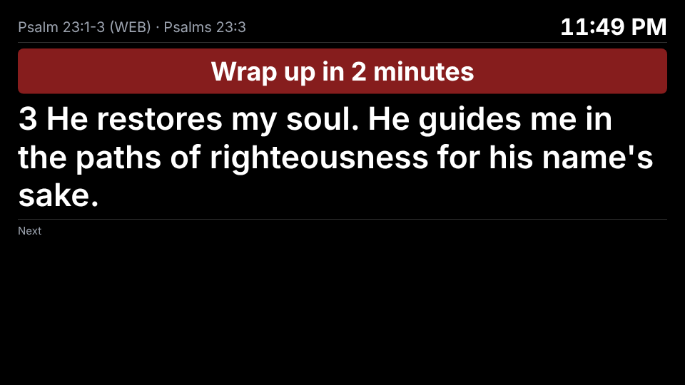

# Lumen

Live presentation software for worship services and events, in the spirit of ProPresenter. It lets you build a song and scripture library, plan the service in a playlist, and run lyrics, backgrounds, messages and countdowns on an audience screen and a stage confidence monitor.


| Audience output | Stage display |
| --- | --- |
|  |  |

## Running it

Requires Node.js 20 or newer.

```sh
npm install
npm run dev          # operator UI at http://localhost:5173
```

Click **Audience** or **Stage** in the toolbar to open the output windows, drag them to the projector or TV, and double-click one to make it fullscreen. In Chromium-based browsers, Lumen asks for permission to place the window on your other screen automatically.

### As a desktop app (Electron)

The desktop shell opens the outputs fullscreen on your second and third displays, with no browser chrome. You can choose the screens in Settings.

```sh
npm run electron     # build, then launch the desktop app
# or, while developing:
npm run dev          # terminal 1
npm run electron:dev # terminal 2, loads the dev server with hot reload
```

### Other scripts

```sh
npm test             # unit tests (Vitest)
npm run typecheck
npm run build        # production build into dist/
npm run format       # Prettier
```

## Features

- **Library** of songs, scripture and announcements, with search across titles and lyrics. Drop `.txt` lyric files on it to import them.
- **Playlists** for each service, with section headers and drag-and-drop ordering. Advancing past the last slide continues into the next item.
- **Slide grid** with group colors (Verse, Chorus, Bridge…). Click a slide to put it live.
- **Text editor** where the lyrics text is the whole presentation: groups, slides, arrangement, captions and stage notes.
- **Themes** with font, size, colors, shadow, outline, alignment, margins, a lower-third box, and color, gradient or media backgrounds. Text shrinks automatically to fit.
- **Media bin** for images and looping videos as backgrounds, stored locally in IndexedDB.
- **Layers** as in ProPresenter: background, slide, message and logo, each cleared on its own, with crossfade transitions.
- **Countdown timer**, either a duration or a time of day, shown on the stage display and usable in messages.
- **Messages** on the audience screen, with `{countdown}` and `{clock}` tokens.
- **Stage display** showing the current and next slide, notes, clock, timer, and a flashing message to the stage.
- **Scripture lookup** of public-domain translations via [bible-api.com](https://bible-api.com), or paste any text.
- **Persistence**: everything saves automatically, and the library exports to and imports from JSON.

## Writing lyrics

```text
[Verse 1]
Amazing grace! How sweet the sound
That saved a wretch like me!

I once was lost, but now am found;
Was blind, but now I see.
> Band drops out here

[Chorus]
...

[Verse 2]
...

[Chorus]
```

| Syntax | Meaning |
| --- | --- |
| `[Name]` | Starts a group. Its color comes from the name. |
| blank line | Starts a new slide |
| `[Name]` with nothing under it | Repeats an earlier group in the arrangement |
| `~ text` | Caption under the slide, such as a scripture reference |
| `> text` | Note shown only on the stage display |

## Keyboard

| Key | Action |
| --- | --- |
| `→` `↓` `Space` `PgDn` | Next slide |
| `←` `↑` `PgUp` | Previous slide |
| `C`, `V`, `B`, … | Jump to the next group starting with that letter |
| `F1` | Clear all |
| `F2` / `F3` / `F4` | Clear slide / media / message |
| `F6` | Toggle logo |

Clickers that send arrow keys or Page Up/Down work out of the box.

## How it works

```
src/
  types.ts         data model: presentations, themes, playlists, live state, output frame
  store.ts         Zustand store: library, playlists, live control, timer (saved to localStorage)
  lyrics.ts        text ⇄ groups/slides/arrangement parser
  frame.ts         derives the OutputFrame from the store; BroadcastChannel sync
  liveFrame.ts     pushes each new frame to output windows and the operator's monitor
  media.ts         IndexedDB storage for images and videos
  outputs.ts       opens output windows (browser popups or Electron windows)
  components/
    ControlApp     operator window layout and keyboard shortcuts
    Canvas         1920×1080 canvas, auto-fitting text, layered output, transitions
    OutputApp      audience window   (#/output)
    StageApp       stage display      (#/stage)
    Library, PresentationPanel, LivePanel, BottomPanel, Dialogs
electron/          desktop shell: display placement, app:// protocol
```

The operator window owns all state. Every change produces an `OutputFrame`, a self-contained description of what each screen should show, which goes to the output windows over `BroadcastChannel`. Output windows hold no library data. They render the frame and load media from the IndexedDB they share with the operator window. Every view renders onto the same fixed 1920×1080 canvas and scales it, so text wraps the same way in thumbnails, the monitor and the projector.

## Roadmap ideas

- Multiple arrangements per song, and per-slide theme overrides
- Free-form slide editor (positioned text boxes, shapes, images)
- Audio bin and video playback with sound and transport controls
- Remote control from a phone over WebSocket
- NDI or capture-card output for livestreams
- Import from ProPresenter, OpenLP, OpenSong, CCLI SongSelect and Planning Center
- CCLI usage reporting
- Installers with electron-builder
